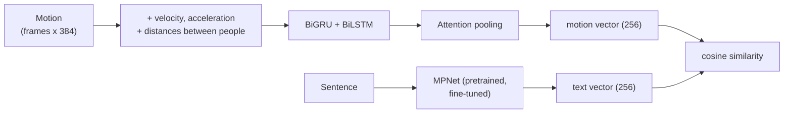

# Motion-to-Text Retrieval

Our team's solution to the [Motion-to-Text Retrieval](https://www.kaggle.com/competitions/motion-to-text-retrieval)
Kaggle challenge (February 2026, Université de Lille). **We finished 1st of 9 teams on the final (private) leaderboard.**

The task: you get a 3D motion of **two people interacting** (a handshake, a push, a hug...)
and a list of 32 sentences. The model has to find the sentence that describes the motion.

**In short:** Python, PyTorch, Hugging Face Transformers, contrastive learning (CLIP-style), scikit-learn, pytest.

## Results

| Leaderboard | Score | Rank |
|---|---|---|
| Public (50% of the test set) | 0.8957 | 2nd / 9 |
| **Private (other 50%, final ranking)** | **0.7027** | **1st / 9** |

The score is a weighted average of Recall@1 to Recall@10, with weight 1/k, so finding the
right sentence first counts a lot more than finding it tenth.

The private half of the test set was harder for everyone. Our score dropped the least
of all 9 teams (−0.19, the others dropped between −0.21 and −0.38), which is how we went from 2nd to 1st.
We think the data augmentation and the strong regularization are why: the model memorized less.

## How it works

Two encoders put motions and sentences in the same 256-dimension space. A motion and its
description should end up close together. To rank the 32 candidates, we just sort them by
cosine similarity with the motion.



**Motion encoder.** Each frame has 192 values per person, starting with the 3D positions of
22 joints. Before the neural network, we add:
- the **velocity and acceleration** of everything, because a push and a light touch can have
  the same poses but very different speeds;
- **4 distances between the two people** (pelvis to pelvis, and between a few other joints),
  because every description is about how the two people interact.

Then a bidirectional GRU and a bidirectional LSTM read the sequence side by side. An attention
layer learns which frames matter most (the moment of the hug, not the walk before it) and
pools the sequence into one vector.

**Text encoder.** [`all-mpnet-base-v2`](https://huggingface.co/sentence-transformers/all-mpnet-base-v2),
a pretrained sentence model, fine-tuned with the rest. With ~6,000 motions there is not enough
text to learn language from scratch, so starting from a model that already understands
sentences matters a lot.

**Training.** Symmetric contrastive loss (InfoNCE, like CLIP): in a batch of 64, each motion
must pick its own sentence among the 64, and each sentence its own motion. The temperature
of the softmax is learned. Other choices:

| Choice | Why |
|---|---|
| Random rotation around the vertical axis | A hug seen from another side is still a hug. Free extra data. |
| Swapping person 1 and person 2 | The sentences say "one person... the other", so the order should not matter. |
| Dropout 0.3, weight decay 0.05 (AdamW) | 6k motions is small and the model overfit quickly. |
| Cosine learning rate schedule, gradient clipping | Stable training with the recurrent layers. |
| Normalization stats from the training set only | No information from validation leaks into preprocessing. |

## A note on validation

During the competition (it lasted 4 days), our final run trained on **all** the labelled motions,
including the ones we had set aside for validation. That is fine for a submission, since more
data helps, but it means the validation numbers we saw at the time were not real held-out scores.

This repo splits the two steps:
1. `train.py` trains on 80% and reports the competition metric on the other 20%, computed the
   same way as the test (groups of 32 candidates). This gives an honest score and the best number of epochs.
2. `train.py --full` retrains on everything for that number of epochs, for the submission.

## What I would try next

- **Use the wrists for the distance features.** We meant to measure hand-to-hand distances,
  but with the usual SMPL joint order, joints 15 and 16 are the head and left shoulder.
  The wrists are 20 and 21.
- **Mask the padding.** Short motions are padded with zeros up to 256 frames, and the attention
  pooling can still look at those empty frames.
- **Rotate the joint rotations too.** The rotation augmentation only rotates the joint positions.
- A transformer instead of the GRU/LSTM, and hard negatives (similar sentences in the same batch).

## Run it

The data comes from the competition page (invitation only), so it is not in this repo.
The easiest way is [`notebooks/kaggle.ipynb`](notebooks/kaggle.ipynb) on a Kaggle GPU.
Locally:

```bash
pip install -r requirements.txt

# 1. train on 80%, validate on 20%
python train.py --data-dir path/to/data --out-dir checkpoints/val_run

# 2. final model on all the data, with the best epoch from step 1
python train.py --data-dir path/to/data --full --epochs 19 --out-dir checkpoints/final

# 3. submission file
python predict.py --data-dir path/to/data --checkpoint checkpoints/final/model.pt

# tests
pytest
```

One training run takes about 30 minutes on a Kaggle GPU (20 epochs).

## Files

```
motion_retrieval/
    data.py      loading, normalization, augmentation
    model.py     motion encoder, text encoder, contrastive loss
    metrics.py   Recall@k and the competition score
train.py         training (with validation, or --full)
predict.py       writes the submission CSV
notebooks/       notebook to run everything on Kaggle
tests/           pytest tests for the metric, augmentation and model shapes
```

## Team

KVA_team. Competition hosted by Hazem Wannous.
Reference paper: [TMR: Text-to-Motion Retrieval Using Contrastive 3D Human Motion Synthesis](https://openaccess.thecvf.com/content/ICCV2023/papers/Petrovich_TMR_Text-to-Motion_Retrieval_Using_Contrastive_3D_Human_Motion_Synthesis_ICCV_2023_paper.pdf) (ICCV 2023).
